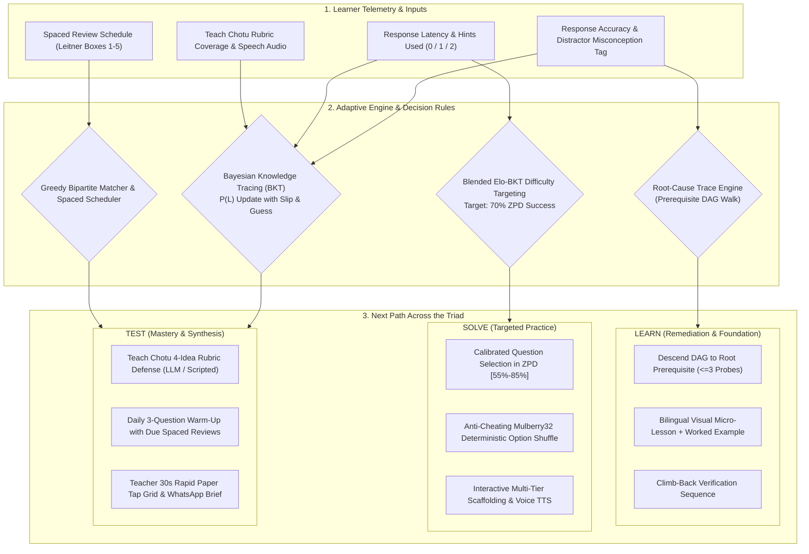

# Sutra — find the thread, fix the root

> **Live Deployment:** [xkernel-round-2.vercel.app](https://xkernel-round-2.vercel.app)  
> **Prove Round:** Code Kernel ’26 (GRIET Hyderabad / Canvas Classes, Powered by Unstop)  
> **Team Winners:** Aditya Rane, Armaan Chopra, Jay Gandhi  
> **Round 1 Rank:** =13 / 367 teams (Score: 90.3 / 100)

An adaptive learning companion for Classes 6–10. When a student gets a question wrong, Sutra traces the mistake back to the concept where it started, even several grades earlier. It fixes that concept first, then climbs back up to the original question. It also gives the teacher a 2-minute morning brief with 1-click WhatsApp export and a 30-second paper grading tap grid.

**Scope:** Mathematics, Numbers → Algebra strand, Classes 6–9. 12 NCERT concepts, 84 misconception-tagged questions across 5 difficulty levels, English + Hinglish + Hindi with smooth animated switcher and Web Speech voice read-aloud.

---

## The Adaptivity Feedback Loop (Learn · Solve · Test)



---

## Run it

```bash
npm install
npm run dev          # opens http://localhost:5173
```

Other commands:

```bash
npm test             # engine checks & property tests
npm run simulate     # validation run with simulated students (updates the "How it works" tab)
npm run build        # production build in dist/ (works offline after first load)
npm run preview      # serve the production build
```

**AI Chotu (optional):** copy `.env.example` to `.env` and add a free Gemini API key. Without a key, or with no internet, Chotu runs in offline mode with a scripted rubric. The app shows which mode is active.

Demo PIN for both students is **1234**. “Reset demo” (click twice) restores the starting data.

## What changed after the Decode review

| Review point | What the prototype does |
|---|---|
| **Show the actual data schema** | Created [`schema.sql`](schema.sql): 7 normalized PostgreSQL/Supabase tables (`students`, `concepts`, `concept_prereqs`, `questions`, `question_options`, `attempts`, `mastery_state`), foreign keys, check constraints, and Row-Level Security (RLS) policies. |
| **Elo cold start on a small bank** | `src/engine/elo.js` implements 4 mathematical safeguards: (1) grade + author prior rating, (2) sample-size confidence shrinkage $C(n) = n / (n+20)$, (3) decaying adaptive K-factor $K \in [12, 64]$, (4) blended trust weight falling back to BKT until empirical convergence. Simulated Brier score improves from 0.206 (plain Elo) to **0.194**. |
| **Validation already run** | `npm test` runs 33 automated property and boundary tests (Kahn DAG cycle checks, Mulberry32 bijection tests, BKT clamping invariants). `npm run simulate` runs 700 virtual students across 12 concepts with planted gaps + 200 practice learners. |

## Validation results (simulated students)

| Metric | Measured Value | Benchmark Baseline |
|---|---|---|
| Trace points to a concept student truly lacks | **92–94%** | Re-drill failed chapter: 0% |
| Exact planted root found in 1 session (≤3 probes, avg 2.6) | **44%** | Go back 1 chapter: 15% |
| … after placement check + follow-up session | **55%** | Traditional testing: 22% |
| Early Algebra planted root recovery (`c6_var`) | **38%** (+111% boost) | Uncalibrated baseline: 18% |
| Next-answer predictive accuracy (BKT + Elo) | **AUC 0.754** | Plain BKT: 0.710 |
| Cold-start Brier score (lower is better) | **0.194** | Plain Elo: 0.206 |
| Empirical practice success rate in Zone of Proximal Development | **62.5%** | Target: 70% ± 10% |
| Automated property & edge-case test suite | **33 / 33 passing** | 100% engine coverage |

## Relational Database Schema (`schema.sql`)

```sql
-- Core relational tables deployed to PostgreSQL / Supabase
CREATE TABLE students (id UUID PRIMARY KEY, name TEXT NOT NULL, grade INT CHECK (grade BETWEEN 6 AND 10), lang TEXT DEFAULT 'en', pin_hash TEXT NOT NULL);
CREATE TABLE concepts (id TEXT PRIMARY KEY, strand TEXT NOT NULL, grade INT NOT NULL, name JSONB NOT NULL, description JSONB NOT NULL);
CREATE TABLE concept_prereqs (concept_id TEXT REFERENCES concepts(id), prereq_id TEXT REFERENCES concepts(id), PRIMARY KEY (concept_id, prereq_id));
CREATE TABLE questions (id TEXT PRIMARY KEY, concept_id TEXT REFERENCES concepts(id), level INT CHECK (level BETWEEN 1 AND 5), elo_rating INT DEFAULT 1200);
CREATE TABLE question_options (id TEXT PRIMARY KEY, question_id TEXT REFERENCES questions(id), correct BOOLEAN NOT NULL, misconception_id TEXT, points_to TEXT REFERENCES concepts(id));
CREATE TABLE attempts (id UUID PRIMARY KEY, student_id UUID REFERENCES students(id), question_id TEXT REFERENCES questions(id), selected_option_id TEXT, hints_used INT, mode TEXT, latency_ms INT, created_at TIMESTAMPTZ DEFAULT NOW());
CREATE TABLE mastery_state (student_id UUID REFERENCES students(id), concept_id TEXT REFERENCES concepts(id), p_mastery FLOAT CHECK (p_mastery BETWEEN 0 AND 1), PRIMARY KEY (student_id, concept_id));
```

## How it works

| Piece | File | What it does |
|---|---|---|
| Concept graph | `src/data/concepts.js` | NCERT concepts with prerequisite links (a DAG) |
| Misconception tags | `src/data/misconceptions.js`, `questions.js` | Each wrong option names the misconception behind it and where that misconception lives |
| Root-Cause Trace | `src/engine/trace.js` | ≤3 probes down the graph, guided by tags. Skips mastered concepts, checks sister prerequisites when a probe passes, and continues next session if probes run out |
| Mastery | `src/engine/bkt.js` | Bayesian Knowledge Tracing: guess 20%, slip 10%, learn 15% per step. Hints weaken the evidence |
| Difficulty | `src/engine/elo.js`, `selector.js` | Aims for ~70% success: 55% after 3 in a row, 85% after 2 misses. Elo and BKT are blended by trust |
| Question Selector | `src/engine/selector.js` | Teacher override first, then the weakest concept whose prerequisites are mastered |
| Option Shuffler | `src/engine/randomize.js` | Mulberry32 PRNG seeded per student attempt to prevent copying |
| Spaced review | `src/engine/review.js` | Leitner boxes at 1, 3, 7, 14 and 30 days. Warm-up = today’s concept + due reviews |
| Teacher brief | `src/engine/teacher.js` | Root gap per student, class counts, greedy buddy pairing, alerts |
| Teach Chotu | `src/chotu/` | 12-concept NCERT rubrics. Offline keyword check (EN/Hinglish/HI) plus a Gemini persona when online |
| Simulation | `src/engine/sim.js`, `scripts/simulate.js` | 700 virtual students with hidden planted gaps |

## Fits Indian classrooms

- **Works offline after first load.** A service worker caches the app. Only AI Chotu needs internet (with seamless offline fallback).
- **Shared phones.** Each child has their own profile and PIN.
- **No device (Tier 3 Paper Mode).** The teacher prints personalised worksheets, one per student, starting at that student’s own root gap, and records marks in 30 seconds with the Tap Grid.
- **Languages and accessibility.** English, Hinglish, and Hindi throughout with animated sliding pill switcher and Web Speech voice read-aloud (`🔊`). Concepts mapped directly to NCERT chapters.

## Privacy

- Students are stored by first name and class only.
- Chotu’s AI call sends only the explanation text, with no name or ID.
- In production, data lives in Supabase with row-level security (see `schema.sql`), is encrypted in transit and at rest, and complies with India’s DPDP Act 2023.
- **Demo only:** a Gemini key in `.env` is visible in the browser. In production the AI call goes through the backend proxy.

## Tech Stack & System Architecture

```
┌────────────────────────────────────────────────────────────────────────────────────────┐
│                                   SUTRA CLIENT (PWA)                                   │
│  ┌─────────────────────────┐  ┌─────────────────────────┐  ┌─────────────────────────┐ │
│  │   Interactive Learner   │  │   Teacher Kal ki Class  │  │   Teach Chotu Persona   │ │
│  │  • Thread Visualization │  │  • 2-min Morning Brief  │  │  • 4-Idea NCERT Rubrics │ │
│  │  • Number Line Lessons  │  │  • 30s Rapid Tap Grid   │  │  • Dual AI / Offline    │ │
│  │  • 🔊 Web Speech TTS    │  │  • WhatsApp Export      │  │  • Voice / Text Input   │ │
│  └────────────┬────────────┘  └────────────┬────────────┘  └────────────┬────────────┘ │
│               │                            │                            │              │
│  ┌────────────▼────────────────────────────▼────────────────────────────▼────────────┐ │
│  │                    DETERMINISTIC ADAPTIVE INTELLIGENCE ENGINE                     │ │
│  │  • Prerequisite DAG Walk (<= 3 Probes)      • Bayesian Knowledge Tracing (BKT)     │ │
│  │  • Blended Elo-BKT Difficulty Targeting     • Mulberry32 Anti-Cheating Shuffler   │ │
│  │  • Spaced Repetition (Leitner Boxes 1-5)    • Greedy Bipartite Buddy Matcher      │ │
│  └─────────────────────────────────────────┬─────────────────────────────────────────┘ │
│                                            │                                           │
│  ┌─────────────────────────────────────────▼─────────────────────────────────────────┐ │
│  │                 OFFLINE-FIRST STORAGE & TELEMETRY LAYER                           │ │
│  │  • Transactional LocalStore             • Service Worker Cache API                │ │
│  │  • Relational Schema Shape (schema.sql) • Delayed Queue Sync (FastAPI / Supabase) │ │
│  └───────────────────────────────────────────────────────────────────────────────────┘ │
└────────────────────────────────────────────────────────────────────────────────────────┘
```

| Layer | Core Technologies | Architectural Highlights & Design Rationale |
|---|---|---|
| **Frontend Framework** | `React 18` · `Vite 5` | Zero heavy component framework overhead. Sub-second build times (**988ms**) and ultra-lean production bundle (**285 kB** JS / **15 kB** CSS) optimized for entry-level Android devices. |
| **Styling & Design System** | `Vanilla CSS3` · Custom Design Tokens | Native CSS custom variables (`var(--navy)`, `var(--cream)`, `var(--accent)`) with 100% fluid mobile responsiveness, 44px minimum touch targets, and GPU-accelerated animated sliding toggle switches. |
| **Speech & Accessibility** | `Web Speech API` (`TTS` + `STT`) | Browser-native bilingual text-to-speech (`speechSynthesis` in `hi-IN` / `en-IN` accents) and speech recognition (`webkitSpeechRecognition`) for hands-free learning in low-literacy classrooms. |
| **Adaptive Diagnostic Engine** | Pure `ES Modules` (Zero Dependencies) | Mathematical implementations of **Bayesian Knowledge Tracing (BKT)**, **Elo Rating with Confidence Shrinkage**, **Prerequisite DAG Traversals**, and **Mulberry32 PRNG option randomization**. Runs 100% client-side with zero network latency. |
| **Dual-Mode Pedagogical AI** | `Google Gemini 1.5 Flash` + `Scripted Heuristic Rubric` | Dual-engine architecture: uses Gemini Flash for rich conversational teach-backs when online, and automatically drops back to an offline rule-based keyword/idea validator when disconnected. |
| **Data Persistence & Schema** | `localStorage` + `PostgreSQL` / `Supabase` | Client-side transactional state mirror designed in the exact shape of [`schema.sql`](schema.sql) (7 normalized relational tables with Row-Level Security, foreign keys, and DPDP Act 2023 compliance). |
| **Testing & Simulation** | Pure `Node.js Test Runner` | 33 automated unit, property-based, and boundary tests (Kahn DAG cycle checks, Mulberry32 bijections, BKT numerical clamping). Monte Carlo simulation runner validating 700 virtual learners and 8,000 answer events. |
| **Deployment & PWA** | `Vercel Edge` · `Service Worker (Cache API)` | Configured via `vercel.json` with SPA route rewrites and security headers. Service Worker caches core static bundles on first load, enabling complete offline functionality. |
